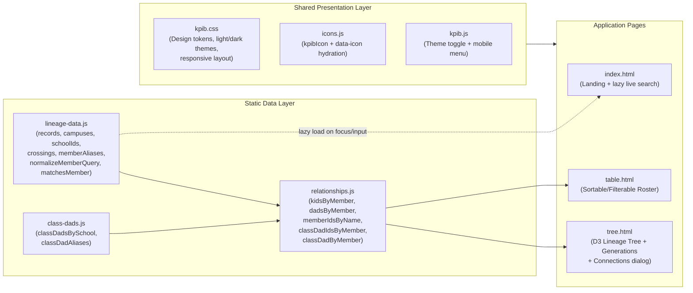
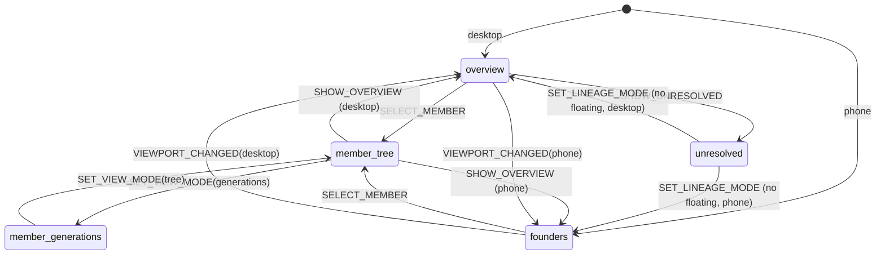

# Product & Technical Specification — Kappa Pi Beta Lineage (`kpib-lineage`)

**Version:** 1.0 (Current Architecture + Hardening Spec)  
**Date:** 2026-11-24  
**Repository:** `https://github.com/Techychris/kpib-lineage`

---

## 1. Product Overview

### 1.1 Purpose
`kpib-lineage` is a static, client-side web application for exploring the fraternal lineage of **Kappa Pi Beta Fraternity, Inc.** (founded March 16, 2000 at Northern Illinois University). Based on the *Kappa Pi Beta Master Binder*, it allows brothers and alumni to trace **Big Brother** and **Class Dad** relationships across 6 campuses and back to the fraternity's 6 founders.

### 1.2 Target Users & Core Jobs-to-be-Done
1. **Quick Member Lookup:** Search any brother by legal name, line name, or alias (accent- and punctuation-insensitive) and jump straight to their position in the lineage tree.
2. **Branch & Ancestry Visualization:** Inspect a brother's upstream chain back to their founder, cross-school transitions, and downstream littles/kids in an interactive pan/zoom tree or structured Generations list.
3. **Roster Exploration & Filtering:** Browse, filter by school, and sort the complete 618-member roster by crossing semester, member name, school, Big Brother, kid count, class dad, campus lineage head, or founder.

### 1.3 Privacy & Deployment Constraints
- **Static Hosting:** Pure HTML/CSS/JS with `.nojekyll` for GitHub Pages deployment; zero server runtime or build step required at serve time.
- **Search Engine Opt-Out:** Every HTML page MUST include `<meta name="robots" content="noindex, nofollow, nosnippet">`.

---

## 2. System Architecture

### 2.1 File Inventory
| File | Responsibility |
| :--- | :--- |
| `index.html` | Landing page, hero live search combobox, founder branch entry cards, reading guide, motion/parallax setup |
| `tree.html` | Interactive D3 pan/zoom tree, Generations list view, Connections `<dialog>`, dual Big Brother / Class Dad modes |
| `table.html` | Searchable, school-filterable, 8-column sortable member table with `sessionStorage` view persistence |
| `lineage-data.js` | 618 member records, 6 campus names, parallel `schoolIds` and `crossings` arrays, `memberAliases`, query normalization & matching |
| `class-dads.js` | Per-campus `"Semester|Cohort"` → class dad name arrays and `classDadAliases` display-name normalizations |
| `relationships.js` | Derives `kidsByMember`, `dadsByMember`, `memberIdsByName`, `classDadIdsByMember`, and `classDadByMember` |
| `icons.js` | 24×24 SVG stroke icon registry (`kpibIcon(name)`) and automatic `[data-icon]` DOM hydration |
| `state-machines.js` | Pure, explicit finite state machines (`createThemeMachine`, `createToggleMachine`, `createLoaderMachine`, `createComboboxMachine`, `createTableMachine`, `createTreeMachine`) |
| `kpib.js` | Light/dark theme toggle and mobile `
` driven by `createThemeMachine` and `createToggleMachine` |
| `kpib.css` | Mobile-first design system tokens, component primitives, responsive breakpoints, dark theme overrides, and reduced-motion rules |
| `d3.min.js` | Vendored D3 v7 (`d3-selection`, `d3-zoom`, `d3-hierarchy`, `d3-shape`, `d3-array`) |

---

## 3. Data Model & Integrity Invariants

### 3.1 Current Data Schema
| Symbol | Type | Semantics |
| :--- | :--- | :--- |
| `records` | `Array<[lineName: string, bigBrotherId: number \| null, isFounder: boolean, realName: string]>` | Positional member table indexed `0..N-1` (currently `N = 618`). |
| `campuses` | `string[]` | Ordered campus names (`0`: Northern Illinois, `1`: UIC, `2`: Mizzou, `3`: Illinois Urbana-Champaign, `4`: Purdue, `5`: Northwestern). |
| `schoolIds` | `number[]` | Parallel array mapping member `id` → index in `campuses`. |
| `crossings` | `Array<[semester: string, cohort: string]>` | Parallel array mapping member `id` → `["Spring\|Fall\|Winter\|Summer YYYY", "<Class Name>"]`. |
| `memberAliases` | `Record<string, string[]>` | Alternate searchable names keyed by exact `record[3]` (legal name). |
| `classDadsBySchool` | `Array<Record<string, string[]>>` | Indexed by `schoolId`, mapping `"${semester}|${cohort}"` → 1 or more class dad display names. |
| `classDadAliases` | `Record<string, string>` | Maps Master Binder class dad spellings/nicknames to exact `record[3]` roster names. |

### 3.2 Derived Relationship Structures (`relationships.js`)
- `dadsByMember[id]`: `string[]` — Raw class dad display names for member `id`'s `(schoolId, semester, cohort)` class, or `[]` (founders).
- `memberIdsByName`: `Map<string, number | null>` — Normalized legal name → unique member ID, or `null` on duplicate names (currently `"richard chang"` collides between IDs `178` and `498`).
- `classDadIdsByMember[id]`: `number[]` — Unique resolved member IDs of all class dads for member `id`.
- `classDadByMember[id]`: `number | null` — First resolved class dad ID (`classDadIdsByMember[id][0] ?? null`), used as single-parent edge in D3 tree mode.
- `kidsByMember[dadId]`: `number[]` — All member IDs whose class lists `dadId` as a class dad (includes both co-dads for multi-dad classes).

### 3.3 Mandatory Dataset Invariants (Verified by Automated Tests)
1. **Array Alignment:** `records.length === schoolIds.length === crossings.length`.
2. **Valid Campuses:** For all `id`, `0 <= schoolIds[id] < campuses.length`, and `classDadsBySchool.length === campuses.length`.
3. **Valid Founders:** Exactly 6 founders (`isFounder === true`), all with `bigBrotherId === null` and `classDadByMember[id] === null`.
4. **Acyclic Forests:** Both Big Brother (`records[i][1]`) and Class Dad (`classDadByMember[i]`) parent graphs MUST contain zero cycles, zero self-references, and zero out-of-bounds indices.
5. **Chronological Consistency:** Every parent (Big Brother or Class Dad) MUST have a `semesterKey` strictly earlier than their child's `semesterKey`.
6. **Complete Class Dad Coverage:** Every non-founder member's `(schoolId, semester|cohort)` key MUST exist in `classDadsBySchool`, and every listed class dad name (after `classDadAliases`) MUST resolve to a valid member ID.
7. **Valid Semester Format:** Every `crossings[i][0]` MUST match `/^(Winter|Spring|Summer|Fall) \d{4}$/`.

### 3.4 Query Normalization & Matching Contract
- `normalizeMemberQuery(value)`:
  1. Unicode `NFD` decomposition, strip combining diacritical marks (`/\p{M}/gu`).
  2. Locale-aware lowercasing (`toLocaleLowerCase()`).
  3. Replace non-alphanumeric Unicode runs (`/[^\p{L}\p{N}]+/gu`) with single ASCII space and `.trim()`.
- `matchesMember(record, normalizedTerm)`:
  - Returns `true` if `normalizedTerm` is a substring of the normalized line name (`record[0]`), normalized legal name (`record[3]`), or any normalized alias in `memberAliases[record[3]]`.

---

## 4. Functional Specifications

### 4.1 Shared Chrome, Theming & Icons (`kpib.js`, `icons.js`)
- **FOUC-Free Theme Init:** Inline `<head>` script reads `localStorage.getItem('kpib-theme')`; if `'dark'`, sets `document.documentElement.dataset.theme = 'dark'` prior to CSS paint. All storage access is wrapped in `try/catch`.
- **Theme Toggle (`#themeToggle`):** Toggles between `'light'` and `'dark'`, persists to `localStorage['kpib-theme']`, updates button icon (`sun` in dark mode, `moon` in light mode), label (`Light`/`Dark`), and `aria-label` (`Switch to light/dark theme`).
- **Mobile Navigation (`details.kp-menu`):** Clicking any link inside `.kp-menu` sets `menu.open = false`. Pressing `Escape` while open closes the menu and returns focus to `
`.
- **Icon Hydration (`icons.js`):** Exposes `window.kpibIcon(name)` returning `<svg viewBox="0 0 24 24" focusable="false">...</svg>` (empty `<svg>` for unknown names). On script load, prepends icon markup to every `[data-icon]` element.

### 4.2 Home Landing Page (`index.html`)
- **Hero Section:** Animated dark circuit-line SVG background (disabled under `prefers-reduced-motion: reduce`), brand stripes, headline, lead copy, primary live search form (`action="tree.html"`), Explore Tree / Browse Table CTAs, and illustrative lineage SVG diagram.
- **Live Search Combobox (`#homeSearch`, `#homeSuggest`):**
  - Lazily injects `lineage-data.js` on first `focus` or `input` (singleton promise; MUST clear cached promise on error per `CR-06`).
  - Ranks matches with prefix matches (`lineName` or `realName` starting with normalized term) before substring matches, breaking ties by member ID.
  - Displays up to 6 clickable `role="option"` items (`<b>lineName</b>realName · Campus`), plus a `role="presentation"` overflow message (`"N more. Press Search to see all."`) when hits > 6, or `"No member matches"` when hits === 0.
  - Keyboard support: `ArrowDown` / `ArrowUp` cycles active index (`aria-activedescendant`, `aria-selected`), `Enter` navigates to `tree.html?member=<id>` when an option is selected (or submits form to `tree.html?q=...` otherwise), `Escape` closes listbox.
  - Pointer support: Clicking an option navigates to `tree.html?member=<id>`; dragging/touching inside `#homeSuggest` keeps the list open without blur-dismissing prematurely; clicking outside closes the list.
- **Founder Grid & Reading Guide:** 6 founder cards linking to `tree.html?member=0..5`, followed by 3 reading-guide cards (`#how-to-read`).
- **Progressive Animations:** Adds `.js` class to `<html>`, assigns stagger variables `--i` and `--d`, reveals sections via `IntersectionObserver` (immediate fallback when unsupported or reduced-motion is preferred), drives hero `--py` parallax via `requestAnimationFrame` passive scroll listener, and measures sticky header height into `--hdr`.

### 4.3 Lineage Tree Explorer (`tree.html`)
- **Layout Breakpoint (`desktopQuery`):**
  - Desktop: `(min-width:701px) and (min-height:521px) and (pointer:fine), (min-width:701px) and (min-height:821px)`.
  - Compact/Phone (`phone.matches = !desktopQuery.matches`): Collapses view controls into a `#viewToggle` popover, moves `#member` into `#viewControls`, defaults orientation to `horizontal`, defaults initial view to `FOUNDERS` card list, and adds `.diagram-open` to `<body>` when viewing a diagram.
- **Lineage Modes (`#lineage`):**
  - `big` (default): Parent = `records[id][1]` (Big Brother), children = littles.
  - `dad`: Parent = `classDadByMember[id]` (Class Dad), children = kids. Persisted in `localStorage['kpib-lineage']`.
  - Unparented non-founders (if any exist) are grouped under synthetic `UNRESOLVED` (`-2`, `"Binder-only branches"`).
- **View States & Navigation:**
  - `OVERVIEW` (`-1`, desktop default): Synthetic `"Kappa Pi Beta"` root connected to all 6 founders.
  - `FOUNDERS` (`-3`, phone default): Vertical card list of the 6 founders.
  - Member Selected (`selected >= 0`):
    - **Focused (`full = false`, "Show downstream" checked):** Renders `selected` as the diagram root with descendants up to `depthLimit`.
    - **Full Branch (`full = true`, "Show downstream" unchecked):** Renders the member's founder (or `UNRESOLVED`) as root with the member's ancestry chain highlighted (`.edge.ancestry`, `.node.on-path`, `.node.selected`).
    - **Generations List (`listView = true`):** BFS-grouped collapsible `
` buckets (first 2 open by default) labeled *Littles / Grand-littles / Great-grand-littles* (`big`) or *Kids / Grandkids / Great-grandkids / Great-great-grandkids* (`dad`), then *Generation N*. Clicking any member selects them.
- **Depth Truncation (`#depth`, `#depthNote`):**
  - Default depth `defaultDepth()` dynamically computes `clamp(3, 7, round(extent / (step * 0.4)))` from canvas width/height and orientation, persisted override `'full'` vs `'5'` in `localStorage['kpib-depth']`.
  - Truncated nodes display a `+N` badge (`.more-badge`) with total hidden descendant count and tooltip text (`"N more below. Click to open."`).
  - *Hardening Requirement (`CR-01`, `CR-02`):* `depthOf` MUST be initialized for children of `OVERVIEW`/`UNRESOLVED`, and `ancestry` nodes MUST never be pruned when `full === true`.
- **D3 Rendering & Controls:**
  - Card size: `206 × 104 px` with left school color stripe (`s0..s5`), truncated line name (`19` chars, or `10` chars when `+N` badge is shown), real name (`25` chars), campus, semester, and cohort (`25` chars).
  - Edges: Solid same-school links, dashed cross-school links (`.cross-school`) with target campus label, red highlighted ancestry links (`.ancestry`).
  - Zoom: `scaleExtent([0.002, 3])`, Zoom In (`×1.25`), Zoom Out (`×0.8`), Fit Diagram, and live percentage `<output id="zoom">`. Phone `fit()` clamps readable trees (`fitted >= 0.25`) to at least `0.72` scale anchored near the root.
  - Keyboard: `Enter`/`Space` on focused SVG node selects it; `Arrow` keys on `#canvas` pan by `48 / scale` units; `Escape` closes `#viewControls` popover or clears `#matches`.
- **Connections Modal (`#connections`, `#connectionsPanel`):**
  - Native `<dialog>` (`showModal()`) displaying selected member metadata, direct Littles/Kids list, co-class-dads section (in `dad` mode when `classDadIdsByMember[id].length > 1`), and ordered `"Path back to the founder"` list. Clicking any listed member closes the modal and selects that member.
- **Deep Linking:**
  - `?member=<digits>` (valid `0 <= id < records.length`): Opens directly to that member.
  - `?q=<text>` (when no valid `member` param): Pre-fills `#query` and submits `#find` (auto-selecting if exactly 1 match, or displaying up to 16 clickable matches).

### 4.4 Member Table (`table.html`)
- **Search & Filtering:**
  - Live text input `#query` matching via `normalizeMemberQuery` + `matchesMember`.
  - School filter buttons (`All schools` + 6 campus short labels with school color dots and full campus `aria-label`), mutually exclusive via `aria-pressed`.
  - Mobile (`<=700px`): Collapses school chips and `#mobileSort` behind `#filterToggle` with live active-filter badge `#filterCount`.
- **Sorting (`applySort`, `compareMembers`):**
  - Default: `crossing` ascending (`semesterKey` = `year * 4 + semesterOrder[term]`, secondary sort by cohort name, final tie-breaker by member legal name via `Intl.Collator(undefined, { sensitivity: 'base', numeric: true })`).
  - Clicking an active column toggles direction (`1` ↔ `-1`). Clicking a new column defaults to ascending (`1`), except `kids` which defaults to descending (`-1`, most kids first).
  - Synchronizes `th[aria-sort]` and `#mobileSort.value`.
- **Columns & Derived Values:**
  1. `Member`: Link to `tree.html?member=<id>`, line name `<small>`, plus compact `.crossing-note` and `.lineage-note` on `<1000px`.
  2. `School`: Color dot + campus name.
  3. `Crossing` (≥1000px): Semester + cohort `<small>`.
  4. `Big Brother`: Link to Big Brother (or `"Founder"`), plus compact `.relationship-notes` on `<1000px`.
  5. `Kids` (≥1000px): `"0 kids"` text or collapsible `
` listing linked kids.
  6. `Class dad`: Comma-joined `dadsByMember[id]` or `"None listed"`.
  7. `Lineage` (≥1000px): Link to earliest same-school ancestor (`lineageStart[id]`) labeled by line name with real name `title`.
  8. `Founder` (≥1000px): Link to root founder (`founders[id]`).
- **View Persistence (`sessionStorage['kpib-roster-view']`):**
  - Saved whenever clicking any `a[href^="tree.html"]` link (`{ query, school, column, direction, scroll }`).
  - Restored and validated on load (`restoreRoster()`).

---

## 5. Explicit Finite State Machines (`state-machines.js`)

All UI state transitions across `kpib.js`, `index.html`, `table.html`, and `tree.html` are governed by pure, explicit state machines in `state-machines.js`—eliminating scattered boolean flags, magic sentinel variables, and DOM-attribute-as-state scraping:

| Machine | Explicit States | Events | Replaces |
| :--- | :--- | :--- | :--- |
| `createThemeMachine` | `'light' \| 'dark'` | `TOGGLE`, `SET` | Implicit `documentElement.dataset.theme` checks in `kpib.js` |
| `createToggleMachine` | `'closed' \| 'open'` (or `'idle' \| 'scheduled'`) | `OPEN`, `CLOSE`, `TOGGLE` | `menu.open` in `kpib.js` and `ticking` boolean in `index.html` parallax |
| `createLoaderMachine` | `'idle' \| 'loading' \| 'loaded' \| 'error'` | `START`, `RESOLVE`, `REJECT` | Unrecoverable `loading` promise cache in `index.html` |
| `createComboboxMachine` | `'closed' \| 'open' \| 'interacting'` | `RESULTS`, `ARROW_DOWN`, `ARROW_UP`, `POINTER_DOWN_LIST`, `BLUR`, `CLOSE` | Racy `keep` boolean + `list.hidden` / `idx` flags in `index.html` |
| `createTableMachine` | `{ query, school, sortColumn, sortDirection, drawer: 'closed' \| 'open' }` | `SET_QUERY`, `SET_SCHOOL`, `TOGGLE_SORT`, `SET_SORT`, `TOGGLE_DRAWER`, `RESTORE` | Separate filter/sort globals + 2nd DOM-scraping `<script>` with `setTimeout(count, 0)` in `table.html` |
| `createTreeMachine` | Discriminated `view.type`: `'founders' \| 'overview' \| 'unresolved' \| 'member-tree' \| 'member-generations'` + `popover`, `connections`, `lineageMode`, `orientation`, `depthMode` | `SELECT_MEMBER`, `SHOW_OVERVIEW`, `SHOW_UNRESOLVED`, `SET_VIEW_MODE`, `SET_SCOPE`, `SET_DEPTH_MODE`, `SET_ORIENTATION`, `SET_LINEAGE_MODE`, `TOGGLE_POPOVER`, `CLOSE_POPOVER`, `OPEN_CONNECTIONS`, `CLOSE_CONNECTIONS`, `VIEWPORT_CHANGED` | 6 entangled flags (`branch`, `selected`, `listView`, `full`, `fullDepth`, `lineageMode`) + DOM `aria-expanded` popover state in `tree.html` |

---

## 6. Non-Functional Requirements & Quality Targets

| Dimension | Target |
| :--- | :--- |
| **Accessibility** | WCAG 2.1 AA minimum (≥ 4.5:1 normal text, ≥ 3.0:1 large text & UI components, full keyboard navigation, ≥ 44×44 px touch targets on coarse pointers, `prefers-reduced-motion` compliance). |
| **Security** | Zero DOM XSS vectors; all data fields rendered via text nodes (`.textContent` / D3 `.text()`); strict URL param validation; `try/catch` around all Web Storage APIs. |
| **Performance** | Initial interactive paint < 1.5s on 4G mobile; table search response < 50ms per keystroke; tree render bounded by depth limit unless user opts into Full Depth. |
| **Testability & Coverage** | **100% line, branch, and function coverage** across all first-party JavaScript modules and inline page scripts, plus automated dataset integrity assertions in CI. |

---

## 6. Recommended Hardening Roadmap (Linked to Audit IDs)

1. **Phase 1 — High-Severity Fixes (P1):** Fix `depthOf` initialization in `OVERVIEW`/`UNRESOLVED` (`CR-01`), preserve `ancestry` past `depthLimit` (`CR-02`/`UX-02`), fix dark-mode `.more-pill` hover contrast (`UX-01`), fix 700–899px `.kp-herobg` breakpoint (`UX-03`), unify co-class-dad `kidsOf` counts (`CR-03`/`UX-04`), and sync `#branch` options on resize (`UX-05`).
2. **Phase 2 — UX & Reliability Polish (P2):** Restore 44px mobile touch targets (`UX-06`), fix Generations caption in Big Brother mode (`UX-07`), guard desktop hero focus auto-scroll (`UX-09`), add URL `pushState` sync (`UX-10`), add `load()` error recovery (`CR-06`), optimize `table.html` search/DOM updates (`CR-07`), and close `<dialog>` on backdrop click (`UX-13`).
3. **Phase 3 — Modularization & Hygiene (P3):** Extract inline scripts into ES modules (`CR-08`), deduplicate `kpib.css` and remove dead classes/`motto-bg.jpg` (`CR-09`/`CR-12`), replace positional-index schema with immutable member IDs (`CR-04`/`CR-05`), and tree-shake `d3.min.js` (`CR-10`).
